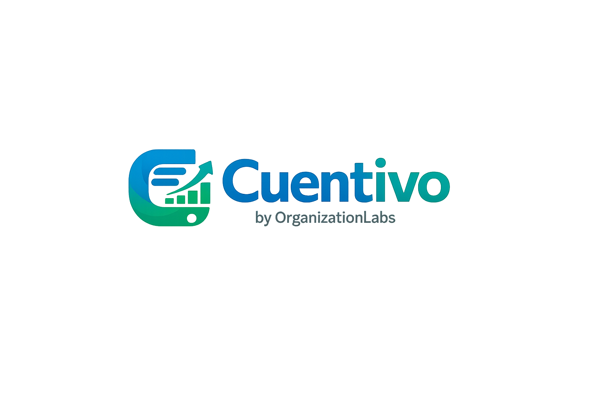
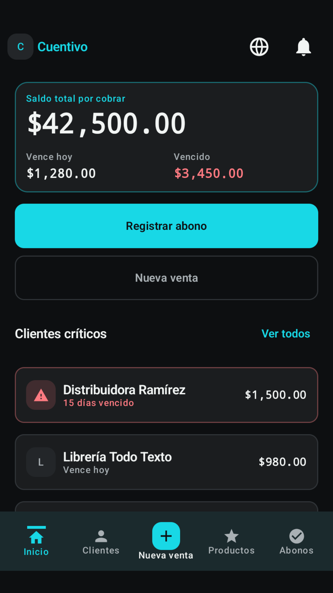
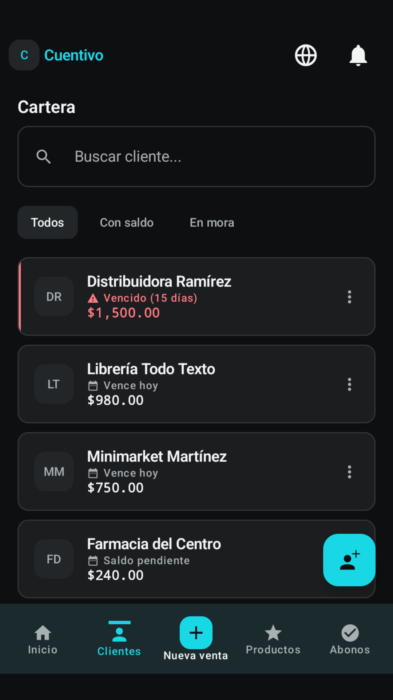
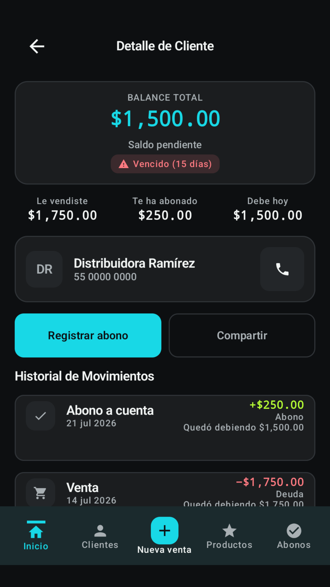
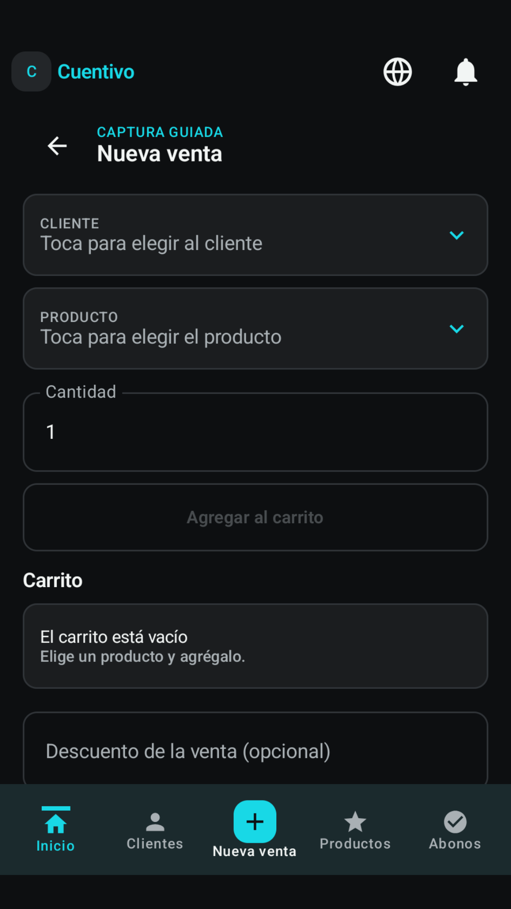
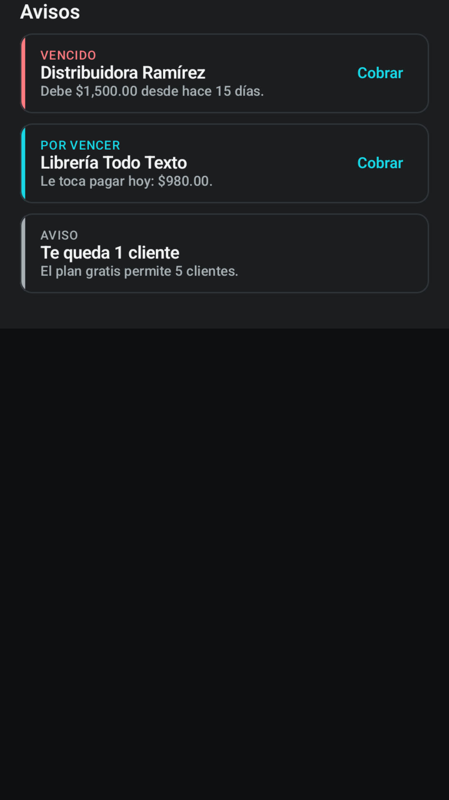
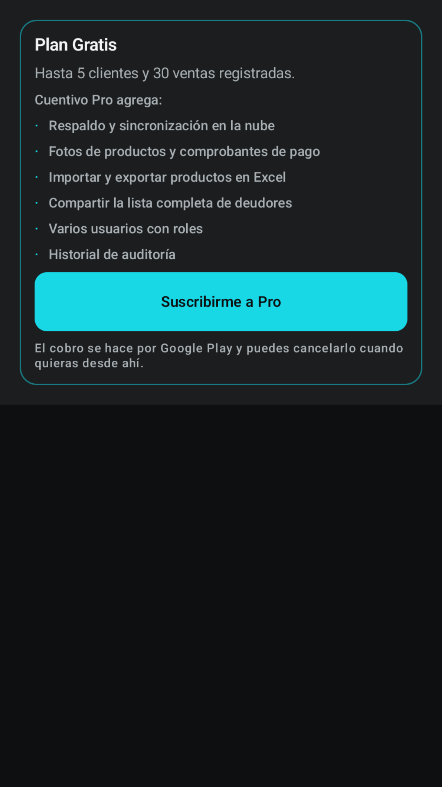
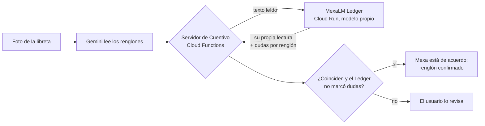

<p align="center">
  
</p>

<h1 align="center">Cuentivo</h1>

<p align="center">
  <b>La libreta de fiado, sin pendientes.</b><br>
  App Android para llevar las cuentas, ventas a crédito y abonos de los negocios mexicanos,<br>
  con lectura de libretas por foto y una <b>verificación cruzada con MexaLM</b>, un modelo propio hecho en México.
</p>

<p align="center">
  <a href="https://play.google.com/store/apps/details?id=com.cuentivo.app">Google Play</a> ·
  <a href="https://mexalm-web.vercel.app">MexaLM</a> ·
  <a href="https://cuentivo-politicasdeprivacidad.vercel.app">Privacidad</a>
</p>

---

## Capturas

| Panel | Clientes | Detalle del cliente |
|:---:|:---:|:---:|
|  |  |  |
| **Nueva venta** | **Avisos** | **Pro** |
|  |  |  |

<sub>Las capturas usan datos de demostración.</sub>

## Qué hace

- **Clientes, ventas a crédito y abonos:** saldo por cliente, vencimientos, "en mora" y un total por cobrar siempre al día.
- **Local-first:** los datos viven en el teléfono (Room). Después de la primera configuración funciona **sin internet**.
- **Foto de la libreta (CuentivoAI):** le tomas foto a tu libreta de papel y la IA propone los renglones: quién, cuánto, si fue venta o abono. **Tú revisas y confirmas**; la IA nunca escribe dinero por su cuenta.
- **Verificación cruzada con MexaLM Ledger:** un segundo modelo, propio, vuelve a leer cada renglón. Si coinciden, la app muestra **"Mexa está de acuerdo"** y quita esa duda. Si el Ledger tiene dudas, el renglón **sigue pidiendo revisión**.
- **Dictado por voz:** "Doña Rosa se llevó dos refrescos de veinte" se convierte en una venta lista para confirmar.
- **Respaldo cifrado** con una contraseña que solo conoce el usuario. **Exportar a Excel (CSV)** y compartir resúmenes.
- **Plan gratis y Pro**, con suscripciones validadas en el servidor (Google Play Billing).

## Cómo funciona la verificación con MexaLM



- [**MexaLM Ledger**](https://mexalm-web.vercel.app) es un modelo pequeño **entrenado desde cero** para libretas de fiado mexicanas. Corre en CPU, con decodificación restringida: no puede inventar cantidades que no estén en el texto.
- **Falla cerrado:** si el Ledger marca un monto, nombre o fecha como dudoso o ilegible, el renglón **no** se confirma, aunque coincida con Gemini.
- **Compatible con versiones viejas:** el servidor solo agrega el bloque de verificación cuando la app lo pide (`acceptsMexalmCrosscheck`). Las versiones anteriores de la app reciben exactamente la respuesta de siempre.
- **El token del Ledger vive solo en el servidor** (Secret Manager). La app nunca lo ve.

## Arquitectura

| Capa | Tecnología |
|---|---|
| App Android | Kotlin · Jetpack Compose (Material 3) · Room · minSdk 24 / targetSdk 36 |
| Backend | Firebase Cloud Functions (Node 22, TypeScript) · Firestore · Firebase Auth · App Check |
| IA | Gemini, solo del lado del servidor y solo para **proponer** · MexaLM Ledger (Cloud Run) para **verificar** |
| Pagos | Google Play Billing con validación en el servidor y notificaciones RTDN |

**Principios de diseño:**
- **La IA propone, Cuentivo calcula y el usuario confirma.** Ningún modelo escribe dinero, inventario ni la base de datos.
- **Llaves solo en el servidor:** la llave de Gemini, la cuenta de servicio de Play y el token del Ledger están en Secret Manager, y las llamadas están protegidas con App Check.
- **Privacidad:** la foto de la libreta es temporal y se borra al terminar la revisión. Los respaldos van cifrados.

## Calidad

- **Cloud Functions:** 604 pruebas (Vitest), incluidas las de compatibilidad con versiones viejas de la app y las de la verificación cruzada.
- **App Android:** 150+ archivos de pruebas unitarias y 50+ de instrumentación (Compose UI, Room, emuladores de Firebase).
- **Reglas de Firestore** auditadas, y `npm audit` en 0 vulnerabilidades.

## Estructura

```
app/               App Android (Kotlin, Compose, Room)
functions/         Cloud Functions (TypeScript): CuentivoAI, Play Billing, cliente del Ledger
shared-fixtures/   Casos de prueba compartidos entre la app y el servidor
firestore.rules    Reglas de seguridad de Firestore
design/ logo/      Identidad visual
docs/              Capturas, ficha de Play y brief de diseño
```

## Compilar y correr

El repositorio **no incluye** llaves, `google-services.json` ni archivos `.env`. Para correrlo necesitas tu propio proyecto de Firebase:

1. Crea un proyecto en Firebase, registra la app Android `com.cuentivo.app` y pon tu `google-services.json` en `app/`.
2. App:
   ```bash
   ./gradlew assembleDebug        # compila
   ./gradlew testDebugUnitTest    # pruebas unitarias
   ```
3. Functions:
   ```bash
   cd functions
   npm ci
   npm test
   cp .env.example .env.<tu-proyecto>   # y llena los valores
   ```
   Los secretos se configuran con `firebase functions:secrets:set` (ver `functions/.env.example`).
4. Emuladores locales: `firebase emulators:start` (Auth, Firestore y Functions).

## Proyecto

Cuentivo es un proyecto de **Capilabs**, hecho en México, y forma parte del ecosistema [MexaLM](https://mexalm-web.vercel.app).

El código se publica para mostrar el proyecto. Si quieres usarlo o colaborar, escríbenos.
